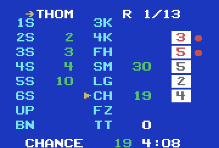
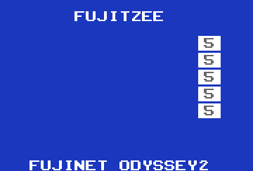
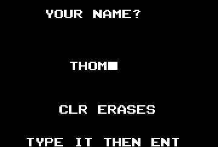
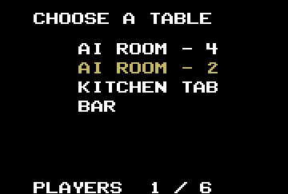
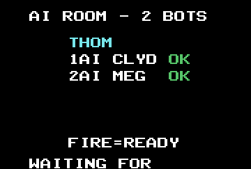
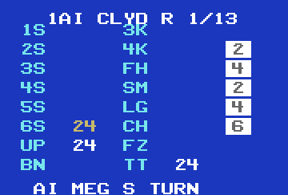
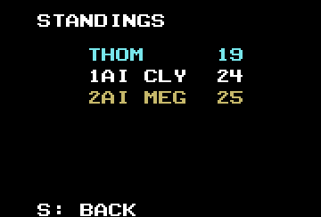
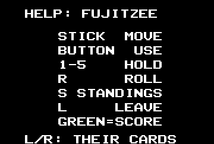
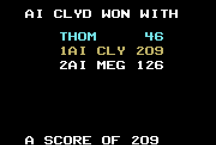

# Fujitzee for the Odyssey 2

Fujitzee for the Magnavox Odyssey 2 / Philips Videopac, over the FujiNet O2
cartridge. It plays the same server as every other client: up to six
players at a table, bots at the AI tables.

It is 8048 assembly (Macroassembler AS), built as a **protocol 2 (APPBANK)**
image: the fixed 1K at `$400-$7FF` holds the display engine, and eight 2K
pages at `$800` hold everything else (17408 bytes). It needs firmware with
APPBANK (fujinet-firmware PR #2177).

The engine, the build checks and the test rig are Texas Hold'em's O2 client
(which is 5 Card Stud's #19/#20, which is Battleship's, which is M.U.L.E.'s).
The game logic is the Channel F port's (`../channelf/src/game.inc`), which
is the Intellivision's by way of the ColecoVision and the Arcadia. Only
tested in MAME (`-cartslot fujinet`), never on a real console.

## Playing

| Where | Stick | Button | Keys |
|---|---|---|---|
| Name (first run) | | | letters, digits, space; CLR rubs out, ENT ends |
| Tables | up/down | join | |
| Lobby | | ready, or not | |
| Your turn | over the card; right of it the dice, below the dice ROLL | score the slot, hold the die, roll | 1-5 hold a die, R rolls |
| Someone else's turn | left/right: another player's card | | |
| Anywhere at the table | | | S standings (and back), L leaves |
| Anywhere but the name | | | H or ? help; any key or the button goes back |

The server rolls the first roll of every turn; two are left. The name is
FujiNet's shared one (appkey creator 1, app 1, key 0). A table the lobby
handed over (key 3, Fujitzee's game type: `<server>?table=<id>`) is joined
without the list; joining writes it there and leaving clears it, as the C
clients and the Channel F do. A room that doesn't answer three times is
cleared and the list shown.

## The screen



The whole card is one screen: the upper section down the left (ones to
sixes, the upper total, the bonus), the lower down the right (set of 3, set
of 4, full house, the straights, chance, Fujitzee, the total) -- the wire's
own slot order, left column slots 0-7, right 8-15. Each cell is a 2-letter
label (cyan) and a value: white once it's filled, green on your turn for
what it would score (a 0 is left off the card), tan for a slot somebody
just took. The total is summed on the client: the server fills slot 15
only at game over.

The dice stand down the right: white cells of the VDC grid in fill mode,
the face a digit on each. A held die is red, with a red ball beside it. The
cursor is a tan arrow. T0 at the top is whose card it is (an arrow when
they're to move) and the round; T1 at the bottom, on your turn, is what's
under the cursor -- the slot's name and what it would score (0 included),
or ROLL and the rolls left -- and the clock (m:ss); otherwise the server's
prompt.

The card follows whoever is rolling. When somebody else's turn ends, their
card stays up for a second and a half with the slot they took lit, and a
falling note. The lobby, the standings and game over are text screens: the
seats with OK when they're ready, or their totals with the leader in tan;
game over's prompt (the winner) is wrapped over T0 and T1.

### Screenshots

From MAME, against a private server:

| | | |
|---|---|---|
|  |  |  |
| The title: five 5s | Your name, the first time | The tables |
|  |  |  |
| The lobby | Your turn: two dice held, a roll left, the cursor on chance | A bot's turn: Clyd's sixes just taken |
|  |  |  |
| The standings (S), the leader in tan | Help (H or ?) | Game over |

### How it's drawn

`src/fixed.inc` re-points the 12 single characters between rows from a
line-counter interrupt (Hold'em's engine, its code unchanged). Every screen
is T0 (the four quads, written in the vblank), eight rows of 11 singles at
Y 30 + 24r, and T1 (the quads again). A row here is the left cell (5
singles), the right cell (5) and a die (1), all at the same X on every row.
Each row band switches the grid off for 3 lines across the grid's row
boundary (`SEPA`, `SEPB`), so the dice stacked down column 8 are five
cells, not one bar. Sprite 0 is the cursor; sprite 1, which every row band
moves down a row, is a held die's ball.

Measured in MAME: `make shot` (every row full, two dice held, the cursor)
and a burst during live play both find no frame that loses a line
(`tools/rowcheck.py`).

**A pass of the main loop.** The keyboard is read once a pass (the BIOS's
`readkey`, only in the quiet stretch after the last band), so a pass has to
be short or a quick key is never seen. Building a row is most of a frame,
so a state draws T0, T1 and row 0, and the main loop draws a row a pass
after it -- the reply is still that state's until the next request begins,
half a second later. The text screens do the same, a step a pass. The dice
and the cursor are drawn from what a state left in RAM: a die's 2 bytes and
the sprite's place are poked directly, never a row. Timed with o2sim's taps
on `KEY`: a pass is 1-2 frames, 4-5 when a state comes, 16 once a game (the
card drawn afresh).

## Building

```
make                                  # build/fujitzee.bin, the live server
make ENDPOINT=http://localhost:8091/  # another server
make spike                            # the engine's test pattern
make run                              # MAME, in a window (run.sh)
```

The build needs `~/asl/asl` and `p2bin` (`ASL=`, `P2BIN=`). After assembling
each page, `build.sh` runs the checks, each for a fault that is silent at run
time: `checkflags` (a JZ testing a MOV), `checkobj` and `checklayout`
(overlaps), `checkmb` (a cross-bank call with no restore), `checkpage` (a
MOVP table outside the page the MOVP runs in), `checkstack` (the 8-level
stack). It also checks the fixed half is the same in every page.
`tools/pageends.py` shows how full each page's sections are.

### Pages

| Page | |
|---|---|
| 0 | boot: cart check, the name (key 0), the room (key 3), the table list, join |
| 1 | the network: CLOSE, OPEN, STATUS until settled, READ; one step a frame |
| 2 | the main loop: keys, stick, polls, dispatch; T1 on your turn |
| 3 | what a state means: the header into RAM, the screen, the turn and roll edges, the slot a bot took, the shadows |
| 4 | every pass: the clock, the dice shaking, the cursor, hold/roll/score, paging, the lobby's ready |
| 5 | help, and name entry |
| 6 | the card: T0, the prompt, a row a pass; the title |
| 7 | the lobby, the standings, game over: a step a pass |

A state is taken only if its length is `95 + 42n` (n 1-12, round 0-13 or
99), the table list only if it is `1 + 36n`.

## Testing

Everything runs headless in MAME through `tools/o2sim.py`. `test/rig.sh`
builds and starts the server from `~/Workspace/servers/fujinet-game-system/
fujitzee/server` on port 8091 (without `GO_PROD` it never posts to the
lobby) and a private fujinet-pc-rs232 on BoIP 19974, with the name appkey
seeded (`NAME=`) and the room appkey if `ROOM=` is set; it refuses an image
not built for it. MAME runs throttled: the server's clocks are wall time.

```
make shot      # the spike: snapshots + tools/rowcheck.py
make test      # boot, a turn, standings, help, leaving, name entry, the room key
make over      # game over in seconds (test/endgame.py: the server's skipToEnd)
make soak      # an AUTOPLAY build plays all 13 rounds at ai4 (four bots)
make two       # ... against test/player.py at the Kitchen Table: two humans
make shots     # screenshots/
```

What has run, all in MAME against the private server: boot, name entry,
the table list, the room handoff (joined, written, cleared on leaving),
the lobby and ready, turns (holds by key and by cursor, rolls, the cursor
over the card, scoring), the bots' turns and their slots lit, the
standings, help, leaving, game over and back to the lobby; a whole game at
ai4 with four bots and a whole game against a second human, every request
a 200; `rowcheck` steady while the game runs.

## Not done

- **The lobby's list of clients.** The server's lobby entry
  (`lobbyClient.go`) has no `o2` client yet, and no image is published at
  `tnfs://ec.tnfs.io/o2/fujitzee.bin`. On a real cart a pushed lobby can't
  boot another APPBANK image yet (fujinet-lobby's O2 README).
- **PAL.** The band timing is NTSC's.
- **Real hardware.** T0 at line 16 and T1 at line 228 may sit in a TV's
  overscan.
- The font has no `'`: "AI CLYD S TURN".
