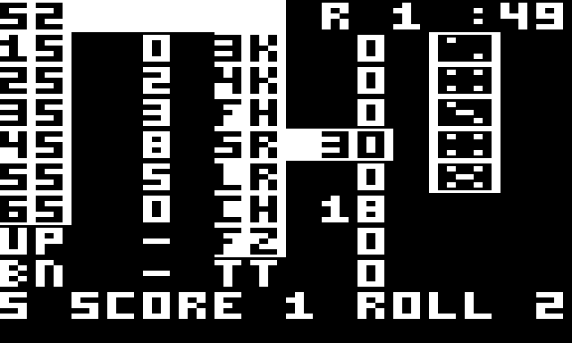
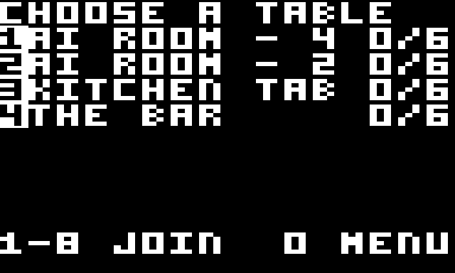
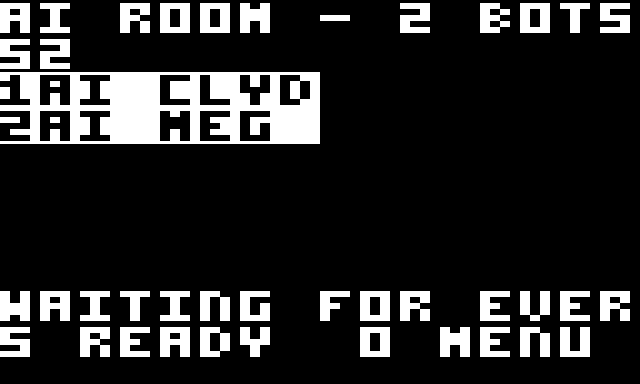
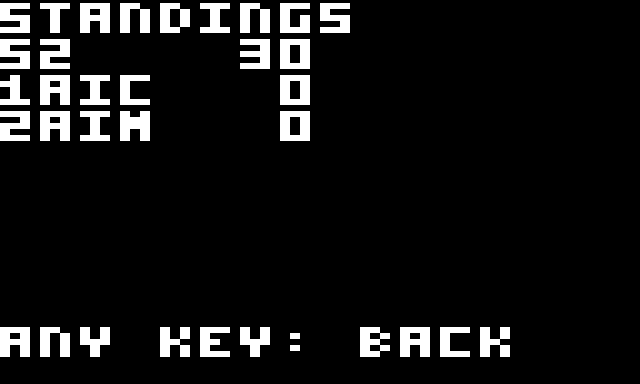

# Fujitzee for the RCA Studio II

Fujitzee for the RCA Studio II, over the FujiNet Studio II cartridge. It plays
the same server as every other client: up to twelve players at a table, bots
at the AI tables.

It is CDP1802 assembly (Macroassembler AS, `CPU 1802`), 6.8K in 33 pages, and
needs only the cart's **protocol 1**: the text engine and app glyphs, no
graphics layer. Only tested in MAME, never on a real console.

The hardware layer (`s2call`, `fujilib`, `fujidisp`, `input`, `fujinet`) is
copied from `fujinet-firmware/pico/studio2/testrom/`; the network layer, name
editor, table list and menu are the Studio II 5 Card Stud's
(`fujinet-5cardstud/studio2`). The game is new: the card, the dice and the
turn logic follow the Channel F port's (`../channelf/src`).

## Playing

Either keypad works (MAME: the numeric pad is pad B, Q W E / A S D / Z X C
pad A).

| Where | Keys |
|---|---|
| Name (first run) | 2468 move over the grid, 5 types, 1 deletes, 3 done |
| Tables | 1-8 joins, 0 the menu |
| Lobby | 5 ready (or not) |
| Your turn | 2468 move the cursor over the card and the dice; 5 holds the die / scores the slot; 1 rolls what you do not hold |
| Someone else's turn | 3 and 9: another player's card |
| At a table | 7 the standings (any key back), 0 the menu (leave, name, CONFIG, help) |

The server rolls the first roll of every turn; two are left. The name is
FujiNet's shared one (appkey creator 1, app 1, key 0).

## The screen



The whole card is one screen, 16 x 10 cells:

```
row 0     S2       R 1 :49      the card's owner (inverse: their turn), round, clock
row 1     1S  0 3K  0 [die]     slot r on the left, slot 8+r on the right
  ...     2S  4 4K  0 [die]     two cells of label, three of value
row 8     BN  - TT  0           
row 9     5 SCORE 1 ROLL 2      the keys on your turn, else the server's prompt
```

* An **inverse label** is a slot you may score now, and its value is what it
  would pay. A scored slot shows its score, an open slot on another card a
  dash. UP and BN are the upper total and bonus, TT the running total (the
  server only fills it at the end, so the client sums slots 6-14).
* The **cursor** is the inverse value, or the arrow beside a die. It parks on
  the best-paying slot when your turn begins and when your rolls run out.
* **Dice** are app glyphs, two cells each (8 x 12 lines; `tools/mkdice.py`
  draws the faces). A held die is inverse. On someone else's turn the dice
  they kept are inverse.
* The view follows whoever is rolling; 3 and 9 turn to another card.

| Tables | Lobby | Standings |
|---|---|---|
|  |  |  |

## Code

| File | |
|---|---|
| `fz.asm` | the memory map, RAM ledger, macros |
| `src/game.inc` | `st_game`: poll, keys, cursor, turn edges (`gcues`) |
| `src/screen.inc` | the play, lobby and standings screens |
| `src/dice.inc` | the glyph loader and the dice column |
| `src/state.inc` | the wire format |
| `src/url.inc` | the requests: `state`, `ready`, `roll/xxxxx`, `score/n`, `leave`, `tables` |
| `src/net.inc`, `nament.inc`, `lobby.inc`, `menu.inc` | from 5 Card Stud |
| `tools/mkdice.py` | die faces to `build/glyphs.inc` |
| `tools/s2sim.py` | the headless MAME scenario runner (from M.U.L.E.'s client) |

Everything is drawn straight out of the reply window at `$E400`; the next
request overwrites it, so only the name, the table and the request's argument
are copied out. A reply is believed only if it is `95 + 42 * playerCount`
bytes. The cart's rules apply: no 3-cycle opcodes (`checkrom.py`), code
outside the pages the runtime owns, short branches on their own page (`FIT`).
The file is `fz.asm`, not `fujitzee.asm`, because the repository's
`.gitignore` hides `fujitzee.*`.

## Build and test

```
make                      # build/fz.st2 against https://fujitzee.carr-designs.com/
make run                  # MAME (~/Workspace/mame-studio2) + fujinet-pc BoIP on 127.0.0.1:9995
make test                 # short scenarios against a private server
make soak                 # a whole game against the bots
```

Needs Macroassembler AS (`~/asl/asl`), `fujinet-firmware` (for `checkrom.py`
and `mkst2.py`; `FUJI_FIRMWARE=`), the Go server in
`servers/fujinet-game-system/fujitzee`, and MAME with the cart grafted in.

`test/rig.sh` starts its own server (port 8097, no lobby posts) and its own
fujinet-pc (BoIP 19976), builds the image for it into `build/rigimg` so
`build/fz.st2` keeps its production endpoint, and runs a scenario
(`test/scen/*.scen`, steps documented in `tools/s2sim.py`). It never touches
production or the fujinet-pc on 9995.

## Not done

* The table the lobby hands over (appkey key 3) is not read or written: you
  pick from the list.
* The game over prompt (who won) is cut to 16 characters.
* There is no `studio2` entry in the server's `lobbyClient.go`, no TNFS image,
  no hardware test.
